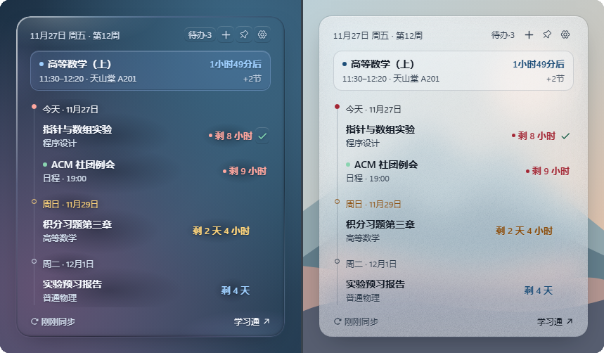
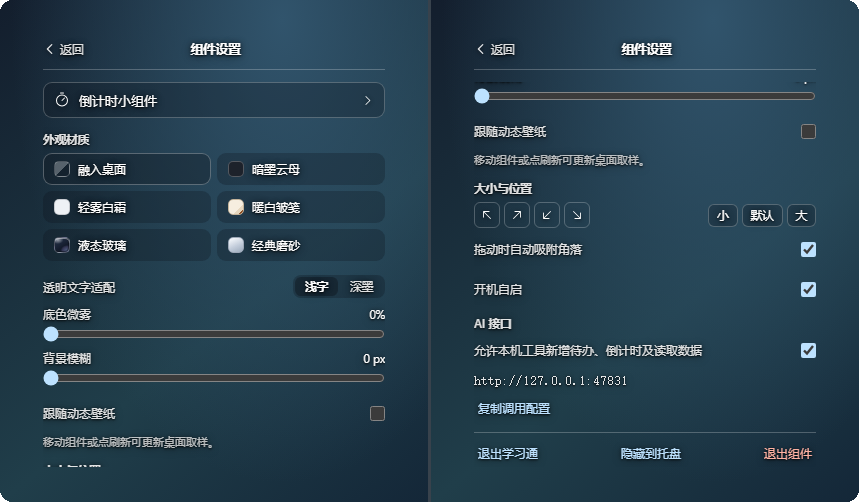

# 作业时钟 · Homework Clock

**下节课在哪、作业还剩多久、今天要做什么，抬眼看桌面就知道。**

作业时钟是一款 Windows 桌面组件。它把学习通未交作业、高校课表、自定义日程和每日待办放到桌面上，也能为考试、答辩或重要日期放一张独立倒计时卡片。

*左为默认的「融入桌面」，右为纸纹主题「暖白皱笺」，界面使用示例数据。*

## 📝 盯住学习通作业

在组件打开的学习通页面登录后，未交作业会按预计截止时间整理到桌面，每 5 分钟同步一次，也可手动刷新。

- **点进去就能做作业。** 桌面列表里点有详情链接的作业，便会打开学习通的对应页面。按页面要求完成答题或上传附件，再在学习通里提交。
- **一键加入今日待办。** 想稍后再做，把鼠标移到作业条目上，点小按钮就能将它加入当天的清单。

| 距离截止 | 桌面显示 |
| --- | --- |
| 超过 72 小时 | 按天显示，使用主题强调色 |
| 72 小时内 | 暖金色提醒，细化到小时，如「剩 2 天 3 小时」 |
| 少于 24 小时 | 珊瑚色提醒，少于 1 小时细化到分钟 |
| 已截止 | 归入列表底部的「已截止」分组 |

截止时间由学习通返回的数据估算，以学习通原页面为准。同一 Windows 用户重启或升级后，仍在有效期内的登录会话会自动沿用。

## 📚 先看今天的课，再排一周的课

首页课程条直接显示下一节课的时间和教室。点进去默认只看**今天还没结束的课**。当天课程全部结束后，会切到下一节课的日期与时间。需要安排整周计划时，切到「周课表」就能前后翻周。

- **按学校查找导入。** 收录 3,377 所高校，可按校名、简称、拼音或地区搜索。其中支持自动导入的学校会打开教务系统，在官方页面登录后直接读取课表。其他学校提供教务入口或官方入口搜索。
- **`.ics` 备用导入。** 手头已有 `.ics` 课表文件可直接导入。目前仅导入兰大教务课表时，会优先按校历识别第一教学周，确认时也可手动调整。

## ✅ 记日程，也勾每日待办

- **自定义日程。** 在首页点 **＋**，选好日期、时间和标记色，日程就会和作业排在同一条时间线上。到点前显示剩余时间，点回条目即可编辑或删除。
- **每日待办。** 点 **待办** 打开按日期组织的清单，可手动添加、勾选完成或删除，也能切到其他日期回看或提前安排。从作业加入今日待办的条目会保留课程名，方便和自己的事项一并处理。

## ⏳ 给考试和答辩单独摆倒计时

在「组件设置 → 倒计时小组件」里新建卡片，也可直接从 Windows 系统托盘打开管理页。每张卡片都能独立设置标题、目标时间和强调色，支持自由摆放、编辑、隐藏或删除，重启后自动恢复位置与显示状态。

*从左到右依次为横条、方形分格、圆形表盘、竖向天数卡。每种形式都可搭配融入桌面、液态玻璃、经典磨砂、暖纸或夜蓝材质。*

## 🎨 贴合桌面，不占任务栏

主组件提供 **融入桌面、暗墨云母、轻雾白霜、暖白皱笺、液态玻璃、经典磨砂** 六种外观材质。首次打开时，默认主题的底色和模糊均为零，尽量不挡壁纸。

*左为液态玻璃，右为经典磨砂。*

- **材质与文字适配。** 透明和玻璃主题可选浅字或深墨。「融入桌面」与「经典磨砂」可分别调节底色和模糊。「液态玻璃」直接透出桌面并使用固定边缘高光。「经典磨砂」可开启「跟随动态壁纸」更新背景取样。
- **移动、缩放与贴角。** 拖顶部移动，拖角落手柄缩放。在设置里可选尺寸预设、放到屏幕四角或开关自动吸附，重启后恢复尺寸和位置。
- **置顶、托盘与自启。** 点图钉切换置顶，主组件不占任务栏。从系统托盘随时显示、隐藏或退出，也可在「组件设置」里开关 Windows 开机自启。

## 🤖 给本机 AI 工具开放接口

打开「组件设置 → AI 接口」后，点「复制调用配置」，即可把本机 HTTP 地址和密钥交给信任的本机工具使用。接口支持**新增待办和独立倒计时**，也可**读取待办、倒计时、作业缓存、日程和课表**。主组件隐藏到托盘后仍可调用。

[查看 AI 接口文档](docs/ai-api.md)

## 🚀 开始使用

前往 [GitHub Releases](https://github.com/makesisisi/homework-clock/releases/latest) 下载最新的 Windows x64 便携版（单文件 EXE 或免安装 ZIP 压缩包），双击运行后点「登录学习通」即可同步作业；课表、日程、待办和独立倒计时可单独使用。

> 首次运行未签名版本时，Windows SmartScreen 可能会弹出提示；下载后可对照 Release 附带的 `SHA256SUMS.txt` 校验文件完整性。如需从源码运行或自行构建，请参阅 [Windows 构建与发布](docs/windows-build.md)。
