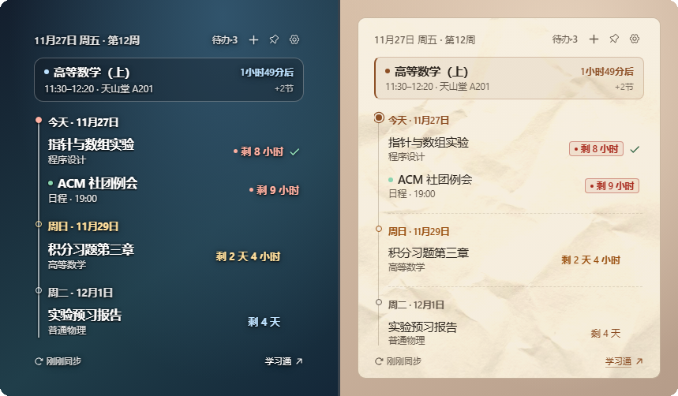
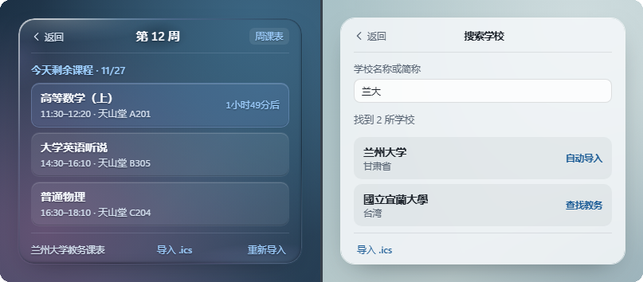
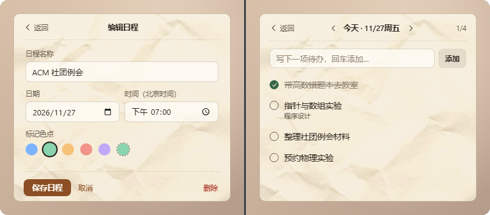
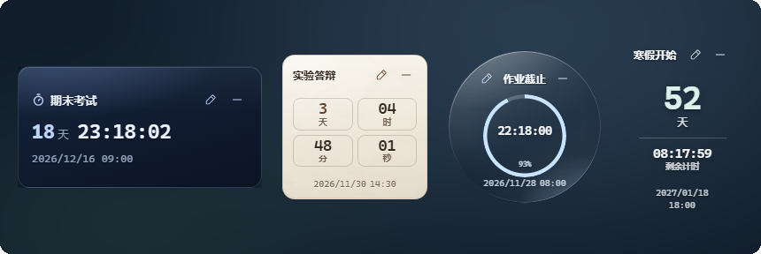

# 作业时钟 · Homework Clock

**下节课在哪、作业还剩多久、今天要做什么，抬眼看桌面就知道。**

作业时钟是一个 Windows 桌面组件。它把学习通未交作业、学校课表和自定义日程放到桌面，也可以为考试、答辩或任何重要日期单独摆一张倒计时卡片。

*左侧为默认的「融入桌面」，右侧为纸纹主题「暖白皱笺」。本文界面使用示例数据。*

## 学习通作业 · 看清什么时候要交

在组件打开的学习通页面登录后，桌面会按预计截止日整理未交作业，每 5 分钟同步一次，也可以手动刷新。点击作业行即可打开学习通详情，悬停可用快捷按钮把作业加入**今日待办**。

| 距离截止 | 桌面怎么显示 |
| --- | --- |
| 超过 72 小时 | 按天显示，使用主题强调色 |
| 72 小时内 | 暖金色提醒，细化到小时，如「剩 2 天 3 小时」 |
| 少于 24 小时 | 珊瑚色提醒，少于 1 小时细化到分钟 |
| 已截止 | 归入列表底部的「已截止」分组 |

截止时间根据学习通返回的数据估算，以学习通原页面为准。同一 Windows 用户重启或升级后可继续使用仍然有效的登录会话。

## 高校课表 · 先看今天，课毕再看下一节

首页课程条显示下一节的时间和教室。点进去默认只看**今天尚未结束的课**，当天课程全部结束后显示下一节课的日期与时间。需要排一周的安排时，可以切换到「周课表」前后翻周。

- **搜索学校。** 内置 3,377 所高校，可按校名、简称、拼音或地区查找。支持自动导入的学校会打开教务系统，在官方页面登录后读取课表。其他学校会提供教务入口或官方入口搜索。
- **导入日历。** 手上已有 `.ics` 课表文件，可以直接导入。导入兰大教务课表时会优先从校历识别第一教学周，也可在确认时手动调整。

## 自定义日程和每日待办 · 安排时间，逐项勾选

首页点 **＋** 新建日程，自选日期、时间和颜色。日程会和作业一起出现在时间线上，到点前显示剩余时间，点回日程即可编辑或删除。

点 **待办** 打开按日期组织的清单，手动添加、勾选完成或删除，也能切换日期回看或提前安排。作业加入今日待办后会保留课程名，便于和自己添加的事项一起处理。

## 独立倒计时 · 给重要日期留一块桌面

在「组件设置 → 倒计时小组件」里新建卡片，也可从 Windows 系统托盘打开管理页。每张卡片都能设置标题、目标时间和强调色，独立摆放、编辑、隐藏或删除，重启后恢复位置和显示状态。

*从左到右为横条、方形分格、圆形表盘、竖向天数卡。每种形式都可搭配融入桌面、液态玻璃、经典磨砂、暖纸或夜蓝材质。*

## 桌面外观和窗口 · 按你的桌面来

主组件提供**融入桌面、暗墨云母、轻雾白霜、暖白皱笺、液态玻璃、经典磨砂**六种材质。首次打开时，默认主题的底色和模糊都是零。透明和玻璃主题可选浅字或深墨，融入桌面和经典磨砂可分别调节底色与模糊。「液态玻璃」直接透出桌面，使用固定边缘高光。「经典磨砂」可开启「跟随动态壁纸」来更新背景取样。

*左侧为液态玻璃，右侧为经典磨砂。*

- **拖动、缩放、贴角。** 拖顶部移动，拖角落手柄缩放。设置里可以选尺寸预设、放到屏幕四角或切换自动吸附，重启后恢复尺寸和位置。
- **置顶、托盘、开机自启。** 点图钉切换置顶，主组件不占任务栏。从系统托盘显示、隐藏或退出组件，在「组件设置」里开关 Windows 开机自启。

## 本机 AI 接口 · 让 AI 也能帮你安排

开启「组件设置 → AI 接口」后，点「复制调用配置」，即可把本机地址和密钥交给自己信任的本机工具。它可以**新增待办或独立倒计时**，也可以**读取待办、倒计时、作业缓存、日程和课表**。组件隐藏到托盘后，接口仍可使用。

[查看 AI 接口文档](docs/ai-api.md)

## 开始使用

双击 Windows x64 便携版 EXE，点「登录学习通」完成登录。课表、日程、待办和独立倒计时可以单独使用。

当前 GitHub 仓库提供源代码。运行项目或自行生成 Windows 便携版，请参阅 [Windows 构建与发布](docs/windows-build.md)。
